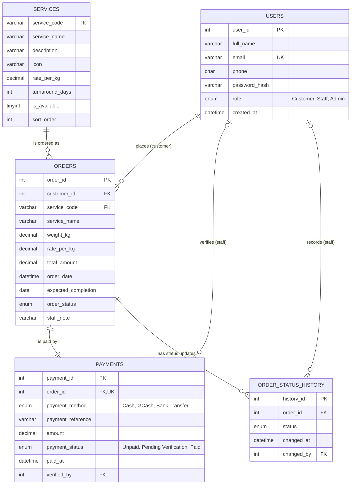

# Database: `metric_laundry` (MySQL / MariaDB)

The system stores its records in MySQL through JDBC (MySQL Connector/J). It was tested with XAMPP's MariaDB 10.4.

- **Script:** [`src/laundry/database.sql`](src/laundry/database.sql). It creates the database, the 5 tables and the sample data.
- **Automatic setup:** the app runs this script when it starts, so the database is created on first run. The script only creates what is missing, so it is safe to run again.
- **Connection settings:** `src/laundry/Database.java`. The defaults are `localhost:3306`, user `root`, no password, which matches XAMPP.

## Entity-Relationship Diagram



## Data dictionary

### users: customer records and staff accounts
| Column | Type | Description |
|---|---|---|
| user_id | INT, PK, auto-increment | Account ID |
| full_name | VARCHAR(100) | Customer or staff name |
| email | VARCHAR(150), unique | Login email |
| phone | CHAR(11) | Contact number, `09XXXXXXXXX` |
| password_hash | VARCHAR(120) | PBKDF2-SHA256 hash with a random salt (no plain-text passwords) |
| role | ENUM('Customer','Staff','Admin') | Customer screens; Staff: Dashboard and Manage Orders; Admin: also Services & Rates and Sales Summary |
| created_at | DATETIME | Date the account was created |

### services: service and pricing list
| Column | Type | Description |
|---|---|---|
| service_code | VARCHAR(20), PK | `WASH_FOLD`, `DRY_CLEAN`, `IRONING` |
| service_name | VARCHAR(60) | Name shown to customers |
| description | VARCHAR(150) | Short description |
| icon | VARCHAR(40) | Icon file shown on screen |
| rate_per_kg | DECIMAL(10,2) | Current rate in pesos per kg (set by the admin) |
| turnaround_days | INT | Days until completion, used for the expected completion date |
| is_available | TINYINT(1) | 1 if the business currently offers the service |
| sort_order | INT | Display order |

### orders: laundry order records
| Column | Type | Description |
|---|---|---|
| order_id | INT, PK, auto-increment | Order number (#001, #002, …) |
| customer_id | INT, FK → users | Customer who placed the order |
| service_code | VARCHAR(20), FK → services | Service ordered |
| service_name | VARCHAR(60) | Service name at the time of the order |
| weight_kg | DECIMAL(6,2) | Laundry weight (0–50 kg) |
| rate_per_kg | DECIMAL(10,2) | Rate charged; later rate changes don't affect it |
| total_amount | DECIMAL(10,2) | weight × rate |
| order_date | DATETIME | When the order was placed |
| expected_completion | DATE | order date + turnaround days |
| order_status | ENUM | Received, Washing, Drying, Ready for Pickup, Claimed |
| staff_note | VARCHAR(255) | Note from staff, shown to the customer |

### payments: payment records (one per order)
| Column | Type | Description |
|---|---|---|
| payment_id | INT, PK, auto-increment | Payment ID |
| order_id | INT, FK → orders, unique | The order being paid |
| payment_method | ENUM | Cash, GCash, Bank Transfer |
| payment_reference | VARCHAR(30), nullable | GCash or bank reference no. (proof of payment) |
| amount | DECIMAL(10,2) | Amount due |
| payment_status | ENUM | Unpaid (cash), Pending Verification (GCash/bank), Paid |
| paid_at | DATETIME, nullable | When staff marked it Paid |
| verified_by | INT, FK → users, nullable | Staff member who confirmed the payment |

### order_status_history: order status records
| Column | Type | Description |
|---|---|---|
| history_id | INT, PK, auto-increment | Entry ID |
| order_id | INT, FK → orders | Order updated |
| status | ENUM | Status recorded |
| changed_at | DATETIME | When it was recorded; shown on the tracking screen |
| changed_by | INT, FK → users, nullable | Staff member who updated it (empty for the initial "Received") |

## Files in the document (Chapter II-e) and their tables

| Record (Chapter II-e) | Table |
|---|---|
| Customer records | `users` |
| Laundry order records | `orders` |
| Service and pricing lists | `services` |
| Payment records | `payments` |
| Order status records | `order_status_history` |
| Receipts and claim stubs | Generated from `orders` + `payments` (View Claim Stub / Payment Receipt) |

## Useful queries (phpMyAdmin → SQL tab)

```sql
-- Orders with customer and payment
SELECT o.order_id, u.full_name, o.service_name, o.weight_kg, o.total_amount,
       p.payment_method, p.payment_status, o.order_status, o.expected_completion
FROM orders o
JOIN users u ON u.user_id = o.customer_id
JOIN payments p ON p.order_id = o.order_id
ORDER BY o.order_id DESC;

-- Sales collected per day
SELECT DATE(paid_at) AS day, COUNT(*) AS payments, SUM(amount) AS collected
FROM payments WHERE payment_status = 'Paid'
GROUP BY DATE(paid_at) ORDER BY day DESC;

-- Status timeline of order #1
SELECT h.status, h.changed_at, u.full_name AS updated_by
FROM order_status_history h LEFT JOIN users u ON u.user_id = h.changed_by
WHERE h.order_id = 1 ORDER BY h.changed_at, h.history_id;
```

## Accounts

| Role | Email | Password |
|---|---|---|
| Customer | juan.dcruz@email.com | password123 |
| Staff | staff@metriclaundry.com | staff123 |
| Admin | admin@metriclaundry.com | admin123 |

To add another staff or admin account, register it in the app, then change its role in phpMyAdmin:

```sql
UPDATE users SET role = 'Staff' WHERE email = 'new.staff@email.com';
```

## Starting over

To reset to the sample data, run `DROP DATABASE metric_laundry;` in phpMyAdmin, then start the app. The database is created again automatically.
